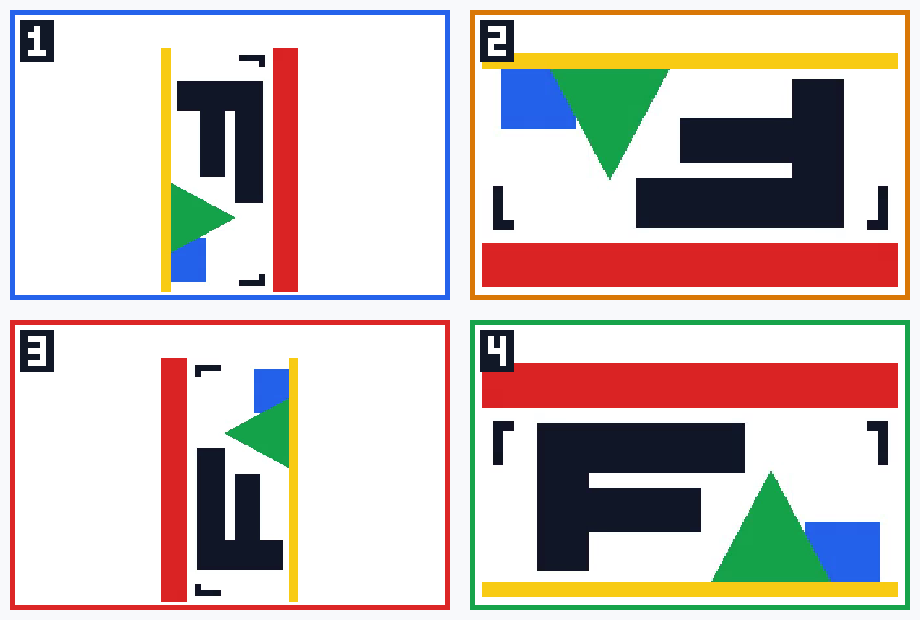

# 旋转/显示矩阵对照报告

- 输入：`examples/double-rotation.mp4`
- 结论：检测到 3 个高风险文件元数据/像素组合（C1-landscape-claim-portrait-pixels-quarter-matrix, C2-baked-pixels-plus-active-display-matrix, C5-display-width-height-vs-matrix-axis-swap）。必须以 -noautorotate 原始像素为准，并用参考图或显式方向确定唯一修正；不要在默认 autorotate 的结果上再次 transpose。

## 三个必须分开的事实

| 检查项 | 值 |
|---|---|
| 真实像素网格（`-noautorotate` 抽帧） | `180x320` / portrait |
| FFprobe 编码宽高 | `180x320` |
| `tkhd` 显示宽高 | `320.00x180.00` / landscape |
| 由 `tkhd`/编码宽高反推 SAR | `3.1605`（极端非 1 表示显示宽高与像素网格被额外拉伸缩放） |
| 显示宽高声明来源 | `mp4-tkhd-pre-matrix-width-height` / landscape |
| MP4 旋转矩阵原始值 | `[0 65536 0 -65536 0 0 0 0 1073741824]` |
| FFprobe rotation | `-90.0°`（本工具换算为顺时针 1/4 圈） |
| 生效矩阵旋转 | 顺时针 `90°` / 1 quarter-turn(s)，换轴=true |
| 矩阵后几何尺寸 | `320x180` / landscape |
| SAR / DAR | `256:81` / `16:9` |
| 真实像素到正向还需 | 顺时针 `270°`（来源：`reference-image-mae`） |
| 播放器遵循矩阵后残余旋转 | `2` quarter-turn(s) |

## 二次旋转组合判定

| ID | 范围 | 组合 | 状态 | 严重度 | 分析/修复 |
|---|---|---|---|---|---|
| `C1-landscape-claim-portrait-pixels-quarter-matrix` | `file` | 横屏声明 × 竖屏真实像素 × 90/270 矩阵 | `confirmed_double_or_conflicting_rotation` | `high` | Raw pixels need 3 clockwise quarter-turn(s) to become upright, but the compliant matrix applies 1. The matrix-respecting image still needs 2 quarter-turn(s); a bake plus matrix or manual filter is rotating the picture twice/in the wrong direction. **修复：** Extract with -noautorotate, compare against an upright reference, then choose exactly one transform: keep the matrix or bake the correct rotation and strip the matrix. |
| `C2-baked-pixels-plus-active-display-matrix` | `file` | 已烘入像素的旋转 × 仍生效的显示矩阵 | `confirmed_same_direction_double_rotation` | `high` | Pixels were already rotated 1 quarter-turn(s) clockwise before encoding, and the display matrix requests the same 1 turn(s). A matrix-respecting player applies both, totaling 2 quarter-turn(s). **修复：** If pixels are already correct, strip/identity the matrix. If pixels are baked sideways, either replace the matrix with the one true correction or bake that correction and write an identity matrix; never do both. |
| `C3-default-autorotate-plus-manual-transpose` | `pipeline` | 默认自动旋转 × 再手动 transpose/rotate | `demonstrated_by_double_rotation_png` | `high` | FFmpeg-based tools and many players apply display-matrix autorotation by default. Running transpose/rotate again on that already-normalized frame applies the matrix a second time. The generated 03-double-rotated PNG reproduces this exact pipeline mistake. **修复：** Use either default autorotate with no rotation filter, or -noautorotate followed by exactly one explicitly chosen correction. |
| `C4-legacy-rotate-tag-plus-display-matrix` | `file` | 旧 rotate 标签 × Display Matrix 被当成两次变换 | `absent` | `info` | No legacy rotate tag found. **修复：** Normalize to one display matrix. Do not add a tag-derived filter when the demuxer/player already exposes/applies side-data rotation. |
| `C5-display-width-height-vs-matrix-axis-swap` | `file` | 显示宽高 × 矩阵换轴 × 真实像素宽高 | `double_axis_swap_display_dimensions` | `high` | tkhd width/height already match the matrix-swapped dimensions while the same quarter-turn matrix remains active. FFmpeg derives an implied SAR of 3.160; SAR-aware rotation then reciprocates that SAR and can change the final display orientation/aspect. Dimension-only players, SAR-aware players, and transcode pipelines can therefore choose different swaps or scaling. **修复：** Keep tkhd dimensions in the pre-matrix track coordinate system for square pixels, or explicitly author a valid anamorphic SAR. Do not pre-swap tkhd width/height and leave the rotation matrix active. |

## 对照帧

### raw-pixels

FFmpeg -noautorotate: true coded pixel grid, with no display matrix applied.  
`01-raw-pixels-noautorotate.png` — 180x320, sha256:`8a7c74a869f1`


### matrix-respecting-player

FFmpeg default autorotate: the same matrix-aware behavior expected from a compliant player.  
`02-matrix-respecting-player.png` — 320x180, sha256:`15e14b4ef267`


### double-rotation-pipeline

Default autorotated frame rotated again by the same matrix quarter-turn: the C3 pipeline mistake.  
`03-double-rotated-autorotate-plus-manual.png` — 180x320, sha256:`af4d9ad13f70`


### raw-candidate-cw0

No-autorotate pixels rotated exactly 0 degrees clockwise; visually choose the upright candidate.  
`candidate-raw-cw0.png` — 180x320, sha256:`47384e42caed`


### raw-candidate-cw90

No-autorotate pixels rotated exactly 90 degrees clockwise; visually choose the upright candidate.  
`candidate-raw-cw90.png` — 320x180, sha256:`02727f1e8afb`


### raw-candidate-cw180

No-autorotate pixels rotated exactly 180 degrees clockwise; visually choose the upright candidate.  
`candidate-raw-cw180.png` — 180x320, sha256:`af4d9ad13f70`


### raw-candidate-cw270

No-autorotate pixels rotated exactly 270 degrees clockwise; visually choose the upright candidate.  
`candidate-raw-cw270.png` — 320x180, sha256:`949b14231894`


### corrected

Corrected from raw pixels with exactly 270 clockwise degree(s), source=reference-image-mae.  
`04-corrected.png` — 320x180, sha256:`949b14231894`


### comparison-sheet

Numbered contact sheet: 1 raw pixels, 2 matrix-aware output, 3 double-rotation pipeline, 4 selected correction.  
`comparison.png` — 920x620, sha256:`f651076f95ea`



## 可执行修复/复测命令

```bash
ffprobe -v error -show_streams -show_format -of json 'examples/double-rotation.mp4'
ffmpeg -hide_banner -loglevel error -noautorotate -i 'examples/double-rotation.mp4' -frames:v 1 raw-pixels.png
ffmpeg -hide_banner -loglevel error -i 'examples/double-rotation.mp4' -frames:v 1 matrix-player.png
ffmpeg -hide_banner -loglevel error -noautorotate -i 'examples/double-rotation.mp4' -frames:v 1 -vf 'transpose=2' corrected-frame.png
ffmpeg -hide_banner -loglevel error -noautorotate -i 'examples/double-rotation.mp4' -vf 'transpose=2' -c:v libx264 -pix_fmt yuv420p -c:a copy corrected-baked.mp4
# 禁止：默认 autorotate 抽帧后再按 ffprobe rotation 手动 transpose；这会复现 03-double-rotated PNG。
```

## 建议下一步

- 先打开 01-raw-pixels-noautorotate.png，确认编码像素网格的真实方向；不要用播放器窗口尺寸代替它。
- 再打开 02-matrix-respecting-player.png，它代表遵循 Display Matrix 的播放器/FFmpeg 默认 autorotate 结果。
- 检查 rotation-report.md 中 C1-C5 的状态；高风险项表示已证实或高度疑似二次旋转。
- 以 04-corrected.png 为准；修复文件时要么清除/改写 tkhd 矩阵，要么烘入唯一旋转后写单位矩阵，不能两者同时保留。
